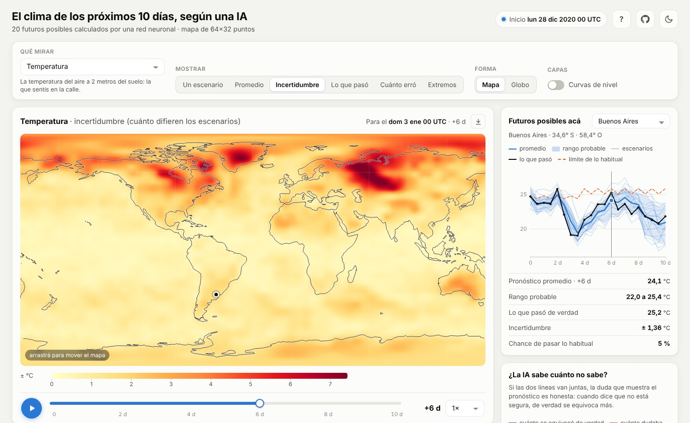
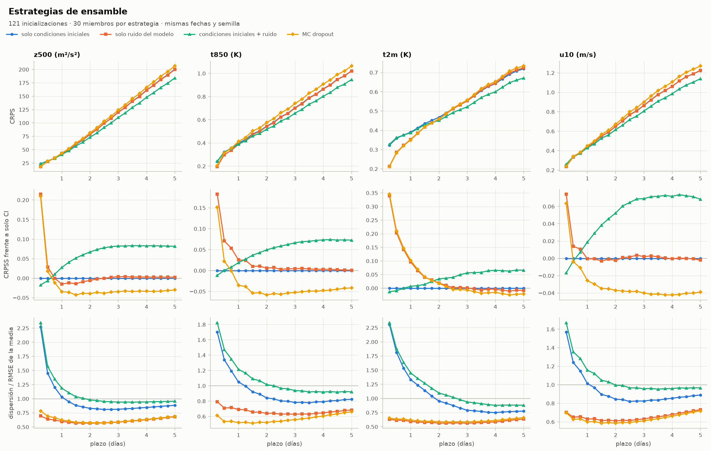
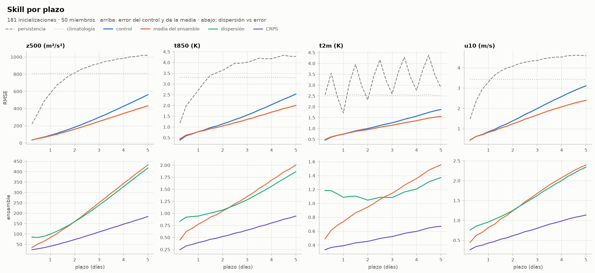
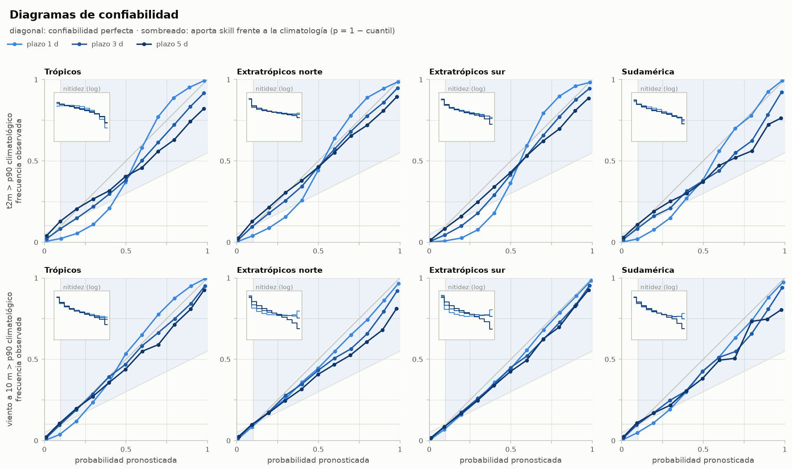
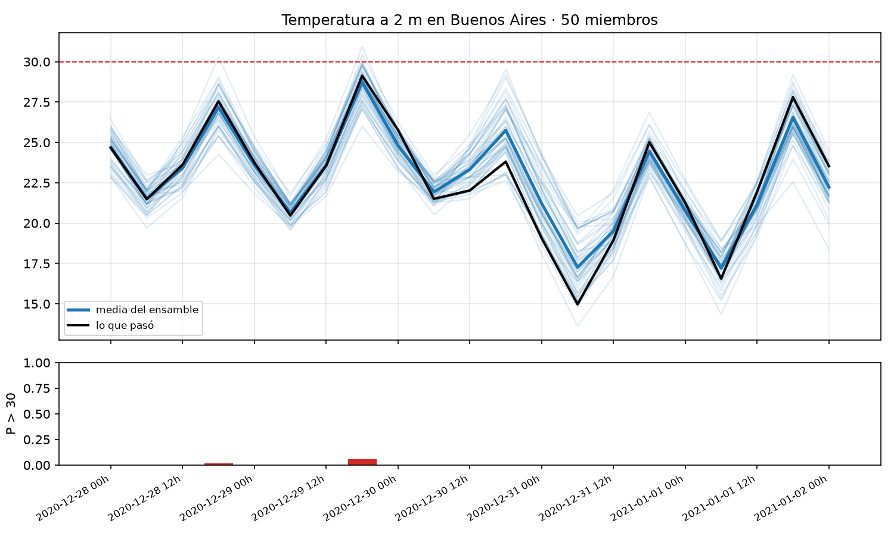
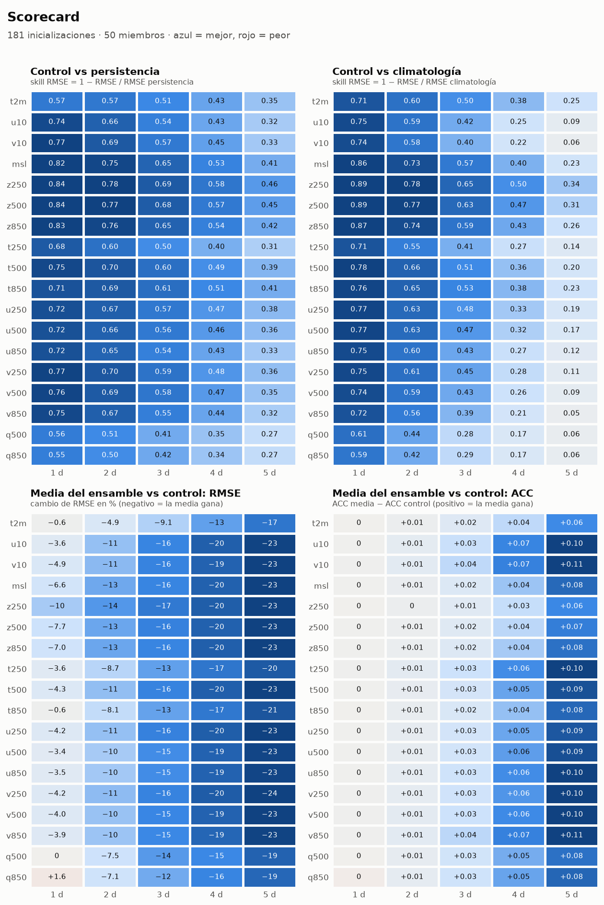
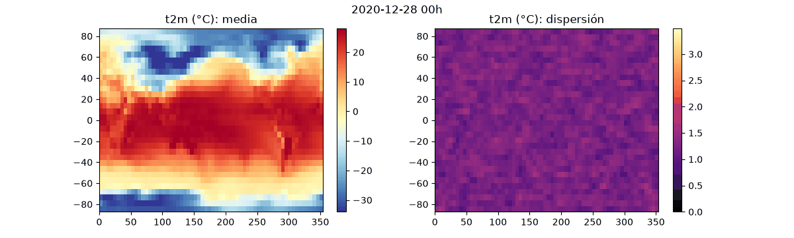
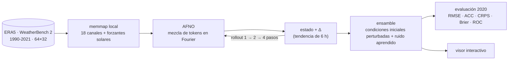

<div align="center">

# 🌎 clima-ensambles

**Pronóstico del clima de todo el planeta con una red neuronal, que además dice cuánto confiar en él.**

Una red AFNO, de la familia de FourCastNet, aprendió de 28 años de datos reales cómo cambia la atmósfera cada 6 horas.
Pronostica 10 días encadenando pasos y corre **50 versiones del futuro** para convertir el pronóstico en probabilidades.
Todo entrenado en una sola RTX 3060.

[](https://github.com/francataldi/clima-ensambles/actions/workflows/ci.yml)


### [▶ Abrir el visor interactivo](https://francataldi.github.io/clima-ensambles/)

<a href="https://francataldi.github.io/clima-ensambles/"></a>

<sub>El visor corre entero en el navegador, en un solo archivo. Tocá cualquier punto del mapa y ves los 20 futuros posibles contra lo que pasó de verdad.</sub>

</div>

---

## En 30 segundos

| | |
|---|---|
| **Qué predice** | 18 variables globales cada 6 h: temperatura, viento, presión, geopotencial y humedad en superficie y en 3 niveles de la atmósfera. |
| **Con qué aprendió** | ERA5 de 1990 a 2017, en una grilla de 64×32 tomada de WeatherBench 2. Validó en 2018-2019 y se evalúa en **2020, un año que nunca vio**. |
| **Por qué ensambles** | La atmósfera es caótica y un error mínimo hoy es una tormenta mal ubicada en 5 días. En vez de un número, el modelo da una distribución. |
| **Cómo lo mido** | Igual que WeatherBench 2: RMSE y ACC ponderados por latitud, CRPS, dispersión contra error, histogramas de rangos, Brier y ROC para eventos extremos. |

## Resultados en 2020

181 pronósticos de 10 días, uno cada 2 días de 2020, con 50 miembros cada uno.

| Variable | Plazo | Media del ensamble | Pronóstico único | Persistencia | Climatología | ACC |
|---|---|---|---|---|---|---|
| Geopotencial en 500 hPa (m²/s²) | 1 día | **83** | 90 | 577 | 809 | 0,99 |
| | 3 días | **251** | 299 | 924 | 810 | 0,93 |
| | 5 días | **433** | 562 | 1021 | 810 | 0,77 |
| Temperatura a 2 m (K) | 1 día | **0,74** | 0,74 | 1,71 | 2,51 | 0,95 |
| | 5 días | **1,55** | 1,88 | 2,87 | 2,51 | 0,71 |
| Viento a 10 m (m/s) | 1 día | **0,82** | 0,85 | 3,30 | 3,42 | 0,97 |
| | 5 días | **2,40** | 3,11 | 4,59 | 3,42 | 0,61 |

<sub>RMSE ponderado por latitud contra ERA5. Persistencia es "mañana igual que hoy" y climatología es el promedio histórico de esa fecha y hora. ACC es la correlación de anomalías del pronóstico único.</sub>

- 🎯 **El ensamble le gana al pronóstico único:** a 5 días, la media de los 50 miembros erra un 23% menos en z500.
- 📏 **Está calibrado:** entre 3 y 5 días la dispersión de los miembros es 0,95 veces el error real. Cuando el ensamble duda, de verdad hay incertidumbre.
- 🔥 **Detecta extremos:** para "temperatura sobre el percentil 90" el área bajo la curva ROC es 0,93 a 1 día y 0,84 a 5 días. En Sudamérica da 0,91 y 0,82.
- 🎲 **La incertidumbre se aprende:** el ruido del modelo, entrenado con CRPS justo y sumado a la perturbación de condiciones iniciales, mejora el CRPS un 8% a 5 días. El ruido solo y el MC dropout quedan subdispersos: sus miembros se parecen demasiado entre sí.

<p align="center"></p>

<details>
<summary><b>Más figuras: skill por plazo, scorecard, confiabilidad y Buenos Aires</b></summary>

<p align="center"></p>
<p align="center"></p>
<p align="center"></p>
<p align="center"></p>
<p align="center"></p>

</details>

## Cómo funciona



1. **El modelo.** Es un *Adaptive Fourier Neural Operator*. Parte el mapa en parches, pasa los tokens a frecuencia con una FFT 2D y los mezcla con un MLP por bloques en el espacio de Fourier, que es una convolución global barata. No predice el estado siguiente sino **el cambio en 6 h**, normalizado por la variabilidad típica de ese cambio. Arranca exactamente en persistencia y aprende la corrección.
2. **Estabilidad a largo plazo.** Entrena primero a 1 paso y después desenrolla 2 y 4 pasos con la pérdida sobre toda la trayectoria. Así aprende a no amplificar sus propios errores al encadenar pronósticos. La pérdida está ponderada por el coseno de la latitud, porque la grilla sobrerrepresenta los polos.
3. **La incertidumbre.** En la última etapa la red recibe canales de ruido espacialmente suave y se entrena con **CRPS justo** sobre 2 miembros: aprende a generar futuros distintos pero plausibles. Al pronosticar se suman perturbaciones suaves a las condiciones iniciales.
4. **La evaluación.** Todo es lo que usa WeatherBench 2. Además hay eventos por región (trópicos, extratrópicos, Sudamérica) con Brier, Brier skill score, confiabilidad y ROC, y un scorecard contra persistencia y climatología.

## Correrlo

```bash
git clone https://github.com/francataldi/clima-ensambles && cd clima-ensambles
pip install -e .[dev]
python -m pytest -q
```

Para probar todo en minutos y en CPU, con datos sintéticos:

```bash
python scripts/make_synthetic.py --out data/sintetico
python scripts/compute_stats.py --data data/sintetico --start 2017-01-01 --end 2018-12-31T18
python scripts/train.py --config configs/sintetico_cpu.yaml
```

Con datos reales. Este es el pipeline completo de `train_3060.bat`:

```bash
python scripts/download_era5.py
python scripts/compute_stats.py
python scripts/train.py --config configs/rtx3060.yaml
python scripts/evaluate.py --checkpoints runs/afno/best.pt --members 50
python scripts/compare_ensembles.py --checkpoints runs/afno/best.pt --every 12 --members 30
python scripts/forecast.py --checkpoints runs/afno/best.pt --init 2020-12-28T00
python scripts/viewer.py --checkpoints runs/afno/best.pt --init 2020-12-28T00 --out docs/index.html
```

| Paso en una RTX 3060 + Ryzen 5 5600X | Tiempo |
|---|---|
| Bajar ERA5 1990-2021 (unos 7 GB) | ~2,5 h |
| Entrenar las 4 etapas (4,7 M de parámetros) | ~6 h, a 71 °C de GPU |
| Evaluar 2020 con 50 miembros | ~30 min |

El entrenamiento retoma solo desde `runs/afno/state.pt` si se corta, y con `--until-stage N` se puede frenar al terminar una etapa.

## Qué hay en el repo

```
clima/
  models/afno.py          AFNO: parches, mezcla espectral por bloques, cabeza en cero
  models/forecaster.py    paso residual, rollout, ruido del modelo, CRPS justo
  data/                   descarga y conversión de WeatherBench 2, memmap, estadísticas, dataset
  ensemble.py             perturbaciones de condiciones iniciales y estrategias de ensamble
  metrics.py, events.py   RMSE, ACC, CRPS, rangos, Brier, confiabilidad, ROC
  evaluate.py, compare.py evaluación tipo WeatherBench y comparación de estrategias
  scorecard.py, plots.py  scorecard y figuras
  viewer.py, viewer.html  visor interactivo autocontenido
scripts/                  puntos de entrada de cada paso
configs/                  rtx3060.yaml (real) y sintetico_cpu.yaml (prueba rápida)
tests/                    55 tests, también en CI sobre Ubuntu y Windows
```

## Limitaciones

- La grilla es de 5,6° (64×32), unas 20 veces más gruesa que la de los modelos operativos. Los números no se comparan directamente con IFS, GraphCast o FourCastNet a 0,25°, pero sí contra persistencia y climatología con la misma métrica.
- Se evalúa contra ERA5, que es un reanálisis y no observaciones directas.
- Son 18 canales y no incluye precipitación.

## Créditos

Datos: [ERA5](https://cds.climate.copernicus.eu/) de Copernicus/ECMWF, a través de [WeatherBench 2](https://sites.research.google/weatherbench/). Costas: [Natural Earth](https://www.naturalearthdata.com/).
Ideas: AFNO ([Guibas et al., 2021](https://arxiv.org/abs/2111.13587)), FourCastNet ([Pathak et al., 2022](https://arxiv.org/abs/2202.11214)) y el CRPS justo para ensambles ([Ferro, 2014](https://doi.org/10.1002/qj.2270)).

<div align="center"><sub>Hecho por <a href="https://www.linkedin.com/in/franco-cataldi-gagliardi-2347a9268">Franco Cataldi Gagliardi</a> · también hice <a href="https://github.com/francataldi/truco-senas">agentes de truco que inventan sus propias señas</a></sub></div>
