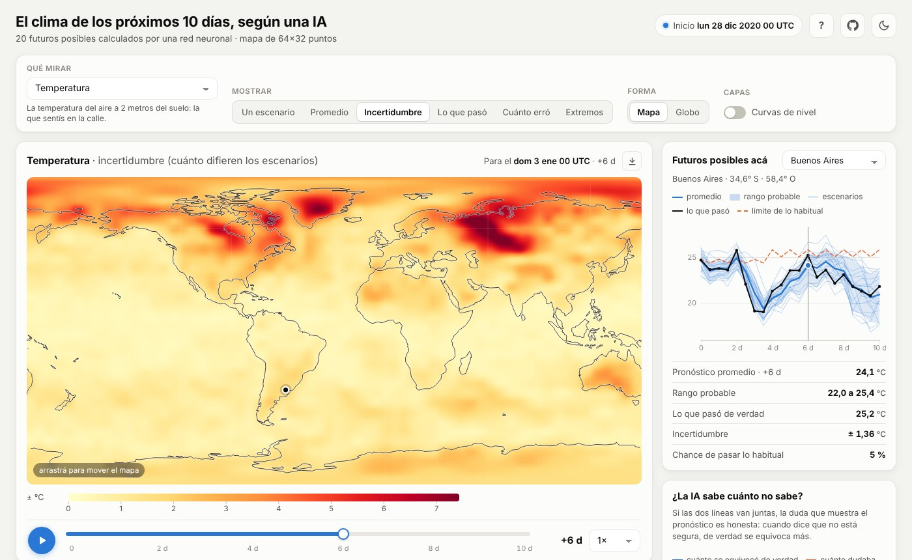
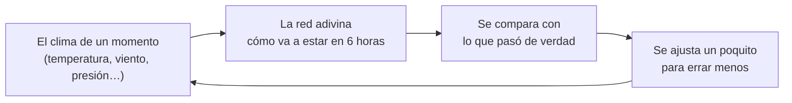
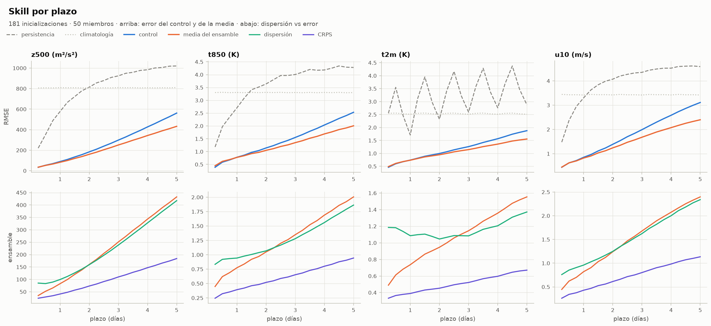
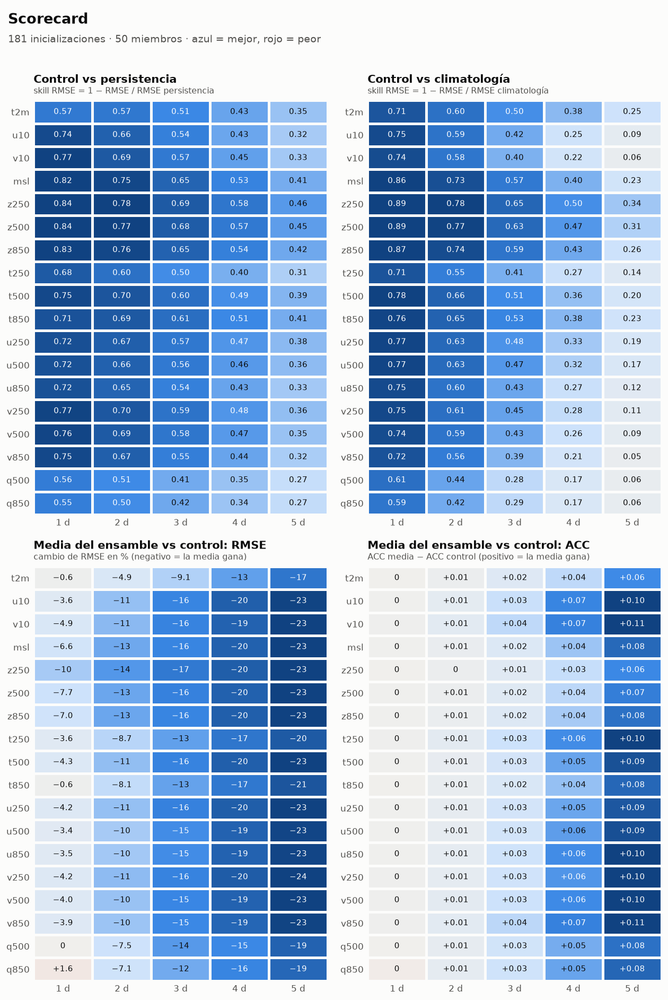
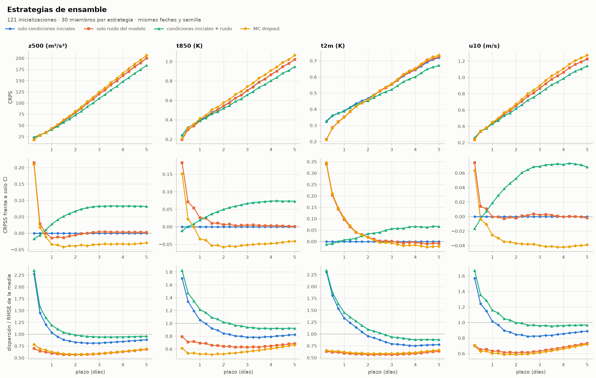
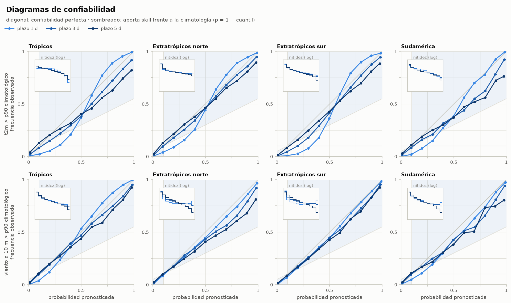
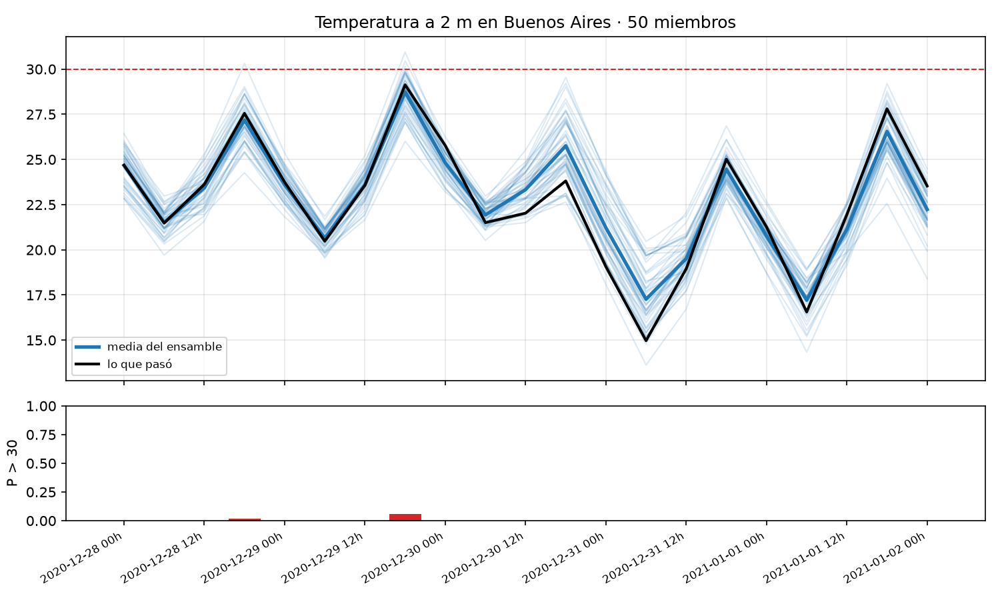
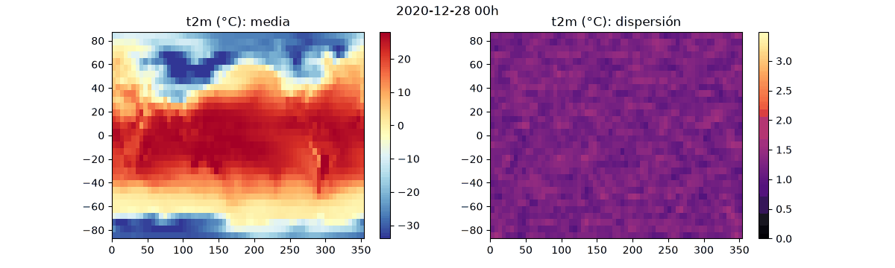

# 🌎 clima-ensambles

**Una red neuronal que pronostica el clima de todo el planeta y, además, avisa cuánto confiar en su pronóstico.**

### [▶ Probalo en el navegador](https://francataldi.github.io/clima-ensambles/)

No hay que instalar nada. Tocá cualquier punto del mapa y ves los futuros posibles para ese lugar, al lado de lo que pasó de verdad.

---

## En 30 segundos

- 🧠 Una red neuronal miró **28 años de clima real** de todo el planeta y aprendió cómo cambia la atmósfera cada 6 horas. Encadenando esos pasos, pronostica varios días.
- 🥊 **Le gana por mucho a las dos apuestas fáciles.** A 1 día, en la altura de las ondas de la atmósfera, se equivoca **7 veces menos** que decir "mañana va a estar igual que hoy" (83 contra 577).
- 🎲 En vez de un solo pronóstico, calcula **50 futuros posibles**. A 5 días, el promedio de los 50 se equivoca un **23% menos** que un pronóstico único.
- 📏 **Sabe cuánto duda.** Entre los 3 y los 5 días, lo que se abren los 50 futuros es 0,95 veces lo que de verdad se equivoca: casi el ideal, que es 1. En el primer día todavía **duda de más**.
- 🔥 **Avisa el calor fuera de lo común.** Si se toma un lugar donde hizo calor extremo y otro donde no, a 1 día el modelo le había dado más chances al correcto **93 de cada 100 veces**, y a 5 días, 84.
- 💻 Todo se entrenó en **una PC de escritorio**, en unas 6 horas.

> **Qué está medido y qué no.** Todos los números salen de 2020, un año que la red nunca vio, y llegan hasta los 5 días. El visor muestra 10 días: del día 6 al 10 todavía no hay medición publicada.

## Si nunca oíste hablar de aprendizaje automático

Imaginá a alguien que mira el cielo todos los días durante 28 años y anota cómo estaba y cómo quedó 6 horas después. Con el tiempo empieza a adivinar: "cuando el viento viene así y la presión baja acá, en 6 horas pasa esto". Nadie le explicó física. Aprendió de ver muchos ejemplos.

Una red neuronal hace eso con números. Prueba adivinar, compara con lo que pasó, se corrige un poquito, y repite millones de veces.

Para pronosticar varios días, la red usa su propia respuesta como punto de partida del paso siguiente: 6 horas, 12, 18 y así.

**¿Y por qué 50 futuros?** La atmósfera es caótica: una diferencia mínima hoy puede ser una tormenta corrida de lugar en 5 días. Como nunca se sabe con exactitud cómo está el clima ahora, el modelo arranca 50 veces desde puntos apenas distintos. Si los 50 futuros se parecen, el pronóstico es confiable. Si se abren para todos lados, conviene tomarlo con pinzas.

## Qué descubrimos

Las mediciones son 181 pronósticos de 5 días repartidos a lo largo de 2020, con 50 futuros cada uno. La tabla muestra el error típico de cada pronóstico: cuanto más bajo, mejor.

### 1. Le gana a las dos apuestas fáciles

Las varas son **"igual que hoy"** (mañana va a estar como hoy) y **"lo normal"** (el promedio histórico para esa fecha y hora). Cualquier pronóstico que valga la pena tiene que ganarles a las dos.

| Qué se pronostica | Plazo | Promedio de los 50 futuros | Un solo pronóstico | "Igual que hoy" | "Lo normal" |
|---|---|---|---|---|---|
| Altura de las ondas de la atmósfera (m²/s²) | 1 día | **83** | 90 | 577 | 809 |
| | 3 días | **251** | 299 | 924 | 810 |
| | 5 días | **433** | 562 | 1021 | 810 |
| Temperatura a 2 m (°C) | 1 día | **0,74** | 0,74 | 1,71 | 2,51 |
| | 5 días | **1,55** | 1,88 | 2,87 | 2,51 |
| Viento a 10 m (m/s) | 1 día | **0,82** | 0,85 | 3,30 | 3,42 |
| | 5 días | **2,40** | 3,11 | 4,59 | 3,42 |

**Por qué importa:** a 5 días el pronóstico todavía se equivoca bastante menos que "lo normal", o sea que sigue aportando información. Estos números todavía no tienen su margen de error: la próxima medición los trae (ver [TECNICO.md](TECNICO.md)).

### 2. Cincuenta futuros valen más que uno

El promedio de los 50 futuros borra los detalles que no se pueden predecir y se queda con lo que todos tienen en común. A 1 día casi no hay diferencia, porque los futuros todavía son parecidos. A 5 días, el promedio se equivoca un **23% menos** en las ondas de la atmósfera y un **18% menos** en temperatura.

**Por qué importa:** la ventaja crece justo donde más hace falta, que es cuando el pronóstico se vuelve incierto.

### 3. Sabe cuánto duda, salvo al principio

Un buen conjunto de futuros se abre tanto como se equivoca. Si se abre menos, es un sobrador; si se abre más, un inseguro. La medida es el cociente entre las dos cosas, y el ideal es 1.

| Plazo | Cuánto se abren los futuros ÷ cuánto se equivoca | Lectura |
|---|---|---|
| 1 día | cerca de 1,2 en las ondas de la atmósfera y de 1,5 en temperatura | duda de más |
| 3 a 5 días | 0,95 | casi justo |

En las primeras 6 horas los futuros se abren más del doble de lo que hace falta. Una explicación probable es que la perturbación con la que arrancan es más grande que la duda real sobre el estado inicial, y con los días esa diferencia se diluye. Ya hay un experimento armado para ajustarla usando 2019, sin tocar el año de prueba.

### 4. La duda también se aprende

Hay cuatro maneras de fabricar futuros distintos. Se compararon con las mismas fechas, usando una medida que premia acertar y también saber cuánto dudar (CRPS, más bajo es mejor).

| Cómo se generan los futuros | Resultado a 5 días |
|---|---|
| Arrancar desde puntos apenas distintos | la referencia |
| Lo anterior **más** un ruido que la red aprendió a usar | **8% mejor** |
| Solo el ruido aprendido | futuros demasiado parecidos entre sí (cociente de 0,6 a 0,7) |
| Apagar partes de la red al azar | futuros demasiado parecidos entre sí (cociente de 0,6 a 0,7) |

**Por qué importa:** combinar las dos fuentes de duda, la del arranque y la del propio modelo, es mejor que cualquiera de las dos sola.

### 5. Avisa el calor fuera de lo común

"Calor fuera de lo común" es una temperatura que en ese lugar, en esa época y a esa hora se supera solo 1 de cada 10 veces. El modelo da una probabilidad: cuántos de los 50 futuros la superan.

| Dónde | A 1 día | A 5 días |
|---|---|---|
| Todo el planeta | 93 de cada 100 | 84 de cada 100 |
| Sudamérica | 91 de cada 100 | 82 de cada 100 |

Cuántas veces, al comparar un caso con calor extremo y uno sin, el modelo le había dado más probabilidad al correcto. Tirar una moneda da 50.

**Por qué importa:** un promedio no sirve para decidir si hay que prepararse para una ola de calor. Una probabilidad sí.

### 6. Queda cerca de lo publicado a esta resolución

El mapa que usa la red es grueso: cada punto cubre unos 600 km. A esa misma resolución hay resultados publicados en el benchmark WeatherBench, medidos con la misma cuenta pero sobre 2017 y 2018, así que la comparación es orientativa.

| Modelo (error en las ondas de la atmósfera, m²/s²) | 3 días | 5 días |
|---|---|---|
| Modelo físico de baja resolución (IFS T42) | 489 | 743 |
| **Este proyecto, un solo pronóstico** | **299** | **562** |
| Red neuronal publicada (ResNet de Rasp y Thuerey, 2021) | 284 | 499 |
| Modelo físico de resolución media (IFS T63) | 268 | 463 |
| **Este proyecto, promedio de 50 futuros** | **251** | **433** |
| El modelo físico europeo en su versión operativa (IFS), la referencia mundial | 154 | 334 |

Los valores publicados son de [Rasp y Thuerey (2021)](https://arxiv.org/abs/2008.08626). El promedio de 50 futuros no se compara uno a uno con un pronóstico único, porque promediar suaviza el mapa.

**Por qué importa:** una PC de escritorio alcanza para quedar en el rango de los modelos de referencia a baja resolución. Está lejos de los modelos de punta, que usan mapas unas 20 veces más finos.

<b>Más figuras: Buenos Aires y la animación de la temperatura</b>

## Cómo se usa el visor

1. Abrí [el visor](https://francataldi.github.io/clima-ensambles/). Muestra un pronóstico que arranca el 28 de diciembre de 2020.
2. En **Qué mirar** elegís la variable: temperatura, viento, presión y otras de altura.
3. En **Mostrar** elegís qué ver en el mapa:

| Opción | Qué muestra |
|---|---|
| Un escenario | Uno solo de los futuros posibles. Con las flechas pasás de uno a otro. |
| Promedio | El promedio de todos los futuros: el pronóstico más probable. |
| Incertidumbre | Dónde los futuros se parecen (claro) y dónde se abren (oscuro). |
| Lo que pasó | El clima real de ese momento, para comparar. |
| Cuánto erró | La diferencia entre el promedio y lo que pasó. |
| Extremos | La chance de superar lo habitual para esa época. |

4. Tocá **cualquier punto del mapa** y a la derecha aparecen los futuros para ese lugar, con la línea negra de lo que pasó.
5. Con el botón de reproducir avanzás en el tiempo, y en **Forma** cambiás entre mapa plano y globo.

## Glosario

| Término | Qué es, en criollo | En este proyecto |
|---|---|---|
| **Red neuronal** | Un programa que aprende de ejemplos en vez de seguir reglas escritas a mano. | Aprende cómo cambia la atmósfera en 6 horas. |
| **Entrenar** | Mostrarle ejemplos y dejar que se corrija sola. | 28 años de clima, de 1990 a 2017. |
| **Año de prueba** | Datos que la red nunca vio, para medirla sin trampa. | Todo 2020. |
| **Ensamble** | Correr el pronóstico muchas veces con arranques apenas distintos. | 50 corridas, cada una es un "futuro posible". |
| **Dispersión** | Cuánto se diferencian los futuros entre sí. Es la duda del pronóstico. | Se compara con el error real. |
| **Persistencia** | La apuesta "mañana igual que hoy". | Primera vara a superar. |
| **Climatología** | La apuesta "lo normal para esta fecha". | Segunda vara a superar. |
| **ERA5** | La mejor reconstrucción del clima real, hora por hora. | De ahí aprende la red y contra eso se la mide. |
| **Ondas de la atmósfera (z500)** | La altura a la que la presión baja a la mitad, a unos 5,5 km. Sus ondas marcan por dónde van los frentes y las tormentas. | Es la variable clásica para comparar pronósticos. |
| **RMSE** | El error típico, en las unidades de lo que se mide. | Los números de las tablas. |
| **CRPS** | Un error para pronósticos con probabilidades: premia acertar y saber cuánto dudar. | Para comparar formas de armar los futuros. |
| **Percentil 90** | El valor que se supera solo 1 de cada 10 veces. | Define "calor fuera de lo común". |
| **Resolución** | El tamaño de cada punto del mapa. | 5,6 grados, unos 600 km. |

## Qué le falta

- El mapa es grueso: sirve para ver frentes y olas de calor grandes, no la lluvia de un barrio.
- No pronostica lluvia.
- Se mide contra ERA5, que es una reconstrucción y no la lectura directa de un termómetro.
- Hay una sola red entrenada. Falta entrenar varias para saber cuánto cambian los números de una a otra.

## Para quien programa

Arquitectura, fórmulas, mediciones con su nombre técnico y cómo correr todo: **[TECNICO.md](TECNICO.md)**.

Hecho por <a href="https://www.linkedin.com/in/franco-cataldi-gagliardi-2347a9268">Franco Cataldi Gagliardi</a> · también hice <a href="https://github.com/francataldi/truco-senas">agentes de truco que inventan sus propias señas</a>

