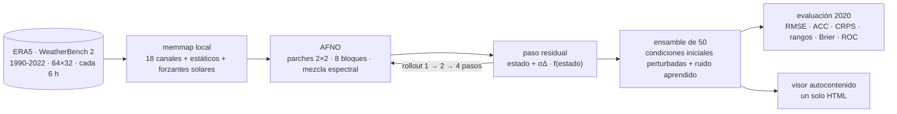

# clima-ensambles · detalles técnicos

Pronóstico global del tiempo a 6 horas con una red AFNO de la familia de FourCastNet, entrenada con ERA5 a 5,625° y desenrollada de forma autorregresiva. La incertidumbre sale de un ensamble de 50 miembros que combina perturbaciones de condiciones iniciales con ruido del modelo entrenado con CRPS justo. La evaluación sigue a WeatherBench 2. La explicación para no especialistas está en el [README](README.md).

## Cómo funciona



- **Datos.** ERA5 regrillado por WeatherBench 2 a 64×32 (5,625°), cada 6 horas. Son 18 canales: `t2m`, `u10`, `v10`, `msl`; `z`, `t`, `u`, `v` en 250, 500 y 850 hPa; `q` en 500 y 850 hPa. Entrenamiento 1990-2017, validación 2018-2019, prueba 2020.
- **Entrada de la red: 33 canales.** Los 18 del estado normalizados, 6 estáticos (máscara tierra-mar, geopotencial de superficie y seno y coseno de latitud y longitud), 5 forzantes (insolación en el tope de la atmósfera y seno y coseno del día del año y de la hora) y 4 de ruido.
- **AFNO.** Parches de 2×2 que dan 512 tokens de dimensión 256, y 8 bloques. Cada bloque hace LayerNorm, mezcla espectral y MLP. La mezcla espectral aplica una FFT 2D, un MLP complejo de dos capas compartido entre frecuencias y diagonal en 8 bloques de canales, un softshrink y la FFT inversa: es una convolución global con costo casi lineal en la cantidad de tokens. Son 4,7 millones de parámetros. La mezcla espectral corre siempre en float32 aunque el resto use bfloat16.
- **Paso residual.** La red predice el cambio en 6 horas, medido en desvíos típicos de ese cambio. La cabeza arranca en cero, así que al inicio el modelo es exactamente la persistencia:

$$
x_{t+1} = x_t + \sigma_{\Delta} \odot f_\theta\big(x_t,\ \text{forzantes}_t,\ \text{ruido}\big)
$$

- **Pérdida ponderada por latitud.** La grilla equiangular sobrerrepresenta los polos, así que cada fila pesa según el coseno de su latitud:

$$
w_j = \frac{\cos(\phi_j)}{\frac{1}{H}\sum_{k}\cos(\phi_k)}
$$

$$
\mathcal{L} = \frac{1}{CHW}\sum_{c,j,i} w_j\,\left(\frac{\hat x_{c,j,i} - x_{c,j,i}}{\sigma_{\Delta,c}}\right)^2
$$

- **Entrenamiento por etapas** (`configs/principal.yaml`, lote de 16, AdamW con coseno y bfloat16). Desenrollar varios pasos con la pérdida sobre toda la trayectoria enseña a no amplificar los propios errores:

| Etapa | Qué hace | Épocas | Learning rate |
|---|---|---|---|
| 1 | rollout de 1 paso, MSE | 40 | 5e-4 |
| 2 | rollout de 2 pasos, MSE | 6 | 1e-4 |
| 3 | rollout de 4 pasos, MSE | 4 | 5e-5 |
| 4 | rollout de 2 pasos, CRPS justo con 2 miembros | 6 | 5e-5 |

- **CRPS justo.** En la etapa 4 la red recibe ruido espacialmente suave en 4 canales y se entrena con el CRPS sin sesgo por tamaño de ensamble ([Ferro, 2014](https://doi.org/10.1002/qj.2270)). Con $M$ miembros $x_i$ y la verdad $y$:

$$
\mathrm{CRPS}_{\text{justo}} = \frac{1}{M}\sum_{i=1}^{M}\lvert x_i - y\rvert \;-\; \frac{1}{2M(M-1)}\sum_{i=1}^{M}\sum_{j=1}^{M}\lvert x_i - x_j\rvert
$$

- **Ensamble.** El miembro 0 es el control: sin perturbación y con ruido cero. El resto suma a las condiciones iniciales un campo gaussiano suave (`ic_scale: 0.5` desvíos de la tendencia de 6 horas, `length_scale: 6`), independiente por canal, y muestrea los canales de ruido del modelo en cada paso.
- **Métricas.** RMSE y dispersión se agregan como en WeatherBench 2, con la raíz después de promediar sobre inicializaciones. La dispersión lleva la corrección por tamaño finito:

$$
\mathrm{RMSE} = \sqrt{\frac{1}{N}\sum_{n=1}^{N}\overline{w\,(\hat x_n - x_n)^2}}
$$

$$
\text{dispersión} = \sqrt{\frac{M+1}{M}\cdot\frac{1}{N}\sum_{n=1}^{N}\overline{w\,\operatorname{Var}_m(x_{n,m})}}
$$

- **ACC**, sin centrar, contra una climatología por mes y hora interpolada linealmente entre meses:

$$
\mathrm{ACC} = \frac{\overline{w\,f'\,o'}}{\sqrt{\overline{w\,f'^2}\;\overline{w\,o'^2}}}
$$

- **Intervalos de confianza.** Bootstrap por bloques circulares sobre las inicializaciones, con 1.000 remuestreos al 95%. El bloque cubre el largo de un pronóstico, porque pronósticos vecinos comparten errores. Las diferencias entre estrategias usan las mismas fechas y el mismo remuestreo, así que el intervalo es pareado.
- **Horizonte útil.** El plazo en que el ACC cruza 0,6, interpolado entre plazos, con su intervalo bootstrap.
- **Eventos.** "Sobre el percentil 90" por punto de grilla, mes y hora, calculado con 1990-2017. La probabilidad pronosticada es la fracción de miembros que lo supera. Se reportan Brier, Brier justo, su descomposición, el Brier skill score contra la climatología y el área bajo la curva ROC, por región.
- **Visor.** Un solo HTML sin dependencias externas. Los campos van cuantizados: la media en uint16 y los desvíos de cada miembro en int8, todo comprimido con gzip y embebido en base64.

## Las mediciones, con su nombre técnico

Todos los valores son de la evaluación sobre 2020: 181 inicializaciones, una cada 2 días, 20 pasos (5 días) y 50 miembros con la estrategia `ci+ruido`.

| Medición | Resultado | De dónde sale |
|---|---|---|
| RMSE de z500 a 1, 3 y 5 días, media del ensamble | 83, 251 y 433 m²/s² | `runs/evaluacion/metrics.csv` |
| RMSE de z500, control | 90, 299 y 562 m²/s² | ídem |
| RMSE de z500, persistencia y climatología | 577, 924 y 1021; 809 | ídem |
| RMSE de t2m a 1 y 5 días, media y control | 0,74 y 1,55 K; 0,74 y 1,88 K | ídem |
| RMSE de u10 a 1 y 5 días, media y control | 0,82 y 2,40 m/s; 0,85 y 3,11 m/s | ídem |
| ACC del control en z500 a 1, 3 y 5 días | 0,99, 0,93 y 0,77 | ídem |
| Mejora de RMSE de la media frente al control a 5 días | 23% en z500, 18% en t2m, 23% en u10 | `runs/evaluacion/scorecard.csv` |
| Dispersión sobre RMSE de la media, 3 a 5 días | 0,95 | `metrics.csv`, columna `spread_skill` |
| Dispersión sobre RMSE de la media, 6 horas y 1 día | cerca de 2,3 y de 1,2 en z500; de 2,3 y de 1,45 en t2m, leído de `estrategias.png` | `runs/comparacion` |
| Área ROC de `t2m > p90`, global, a 1 y 5 días | 0,93 y 0,84 | `runs/evaluacion/eventos.csv` |
| Área ROC de `t2m > p90`, Sudamérica, a 1 y 5 días | 0,91 y 0,82 | ídem |
| Brier skill score de `t2m > p90`, global, a 1 día | 0,46 | ídem |
| CRPS de `ci+ruido` frente a `ci` a 5 días | 8% mejor en z500 | `runs/comparacion/comparacion_ensambles.csv`, 121 inicializaciones y 30 miembros |
| Dispersión sobre RMSE de `ruido` y `mc_dropout` | 0,6 a 0,7 | ídem |

**Sobre estos números.** Salen de la primera evaluación, que promediaba el RMSE de cada inicialización (la convención de WeatherBench 1), usaba un ACC centrado y una climatología sin interpolar, y no guardaba los valores por inicialización. Por eso todavía no tienen intervalo. El código actual agrega como WeatherBench 2, evalúa 10 días y calcula los intervalos. `medir_todo.bat` regenera todo y deja además el RMSE con la convención vieja en `det_rmse_por_inicio` y `mean_rmse_por_inicio`, para seguir comparando con WeatherBench 1. Con la raíz después de promediar, los RMSE van a dar algo más altos.

### Contra WeatherBench 1, a la misma resolución

Los valores publicados son de [Rasp y Thuerey (2021)](https://arxiv.org/abs/2008.08626), tabla 1: RMSE ponderado por latitud y promediado sobre pronósticos, a 5,625°, sobre 2017-2018. Los de este proyecto son sobre 2020, así que la comparación es orientativa.

| Modelo | z500 a 3 días | z500 a 5 días | t2m a 5 días |
|---|---|---|---|
| Persistencia, publicada | 936 | 1033 | 3,27 |
| Persistencia, este proyecto | 924 | 1021 | 2,87 |
| Climatología semanal, publicada | 816 | 816 | 3,19 |
| Climatología por mes y hora, este proyecto | 810 | 810 | 2,51 |
| IFS T42 | 489 | 743 | 3,69 |
| **Control, este proyecto** | **299** | **562** | **1,88** |
| ResNet continuo preentrenado con CMIP | 284 | 499 | 1,92 |
| IFS T63 | 268 | 463 | 2,44 |
| **Media del ensamble, este proyecto** | **251** | **433** | **1,55** |
| IFS operativo | 154 | 334 | 1,77 |

Que la persistencia y la climatología propias coincidan con las publicadas a menos del 2% en z500 indica que la métrica está bien implementada. La media de un ensamble no es comparable uno a uno con un pronóstico determinístico, porque promediar suaviza los campos y eso baja el RMSE.

## Reproducirlo

```bash
python scripts/download_era5.py --out data/era5_64x32 --start 1990 --end 2022
python scripts/compute_stats.py --data data/era5_64x32 --start 1990-01-01 --end 2017-12-31T18
python scripts/train.py --config configs/principal.yaml
python scripts/evaluate.py --checkpoints runs/afno/best.pt --start 2020-01-01 --end 2020-12-31T18 --steps 40 --members 50 --out runs/evaluacion
python scripts/compare_ensembles.py --checkpoints runs/afno/best.pt --start 2020-01-01 --end 2020-12-31T18 --every 12 --members 30 --out runs/comparacion
python scripts/calibrate_ensemble.py --checkpoints runs/afno/best.pt --start 2019-01-01 --end 2019-12-31T18 --every 12 --members 30 --out runs/calibracion
python scripts/forecast.py --checkpoints runs/afno/best.pt --init 2020-12-28T00 --steps 40 --members 50 --out runs/pronostico
python scripts/viewer.py --checkpoints runs/afno/best.pt --init 2020-12-28T00 --members 20 --out docs/index.html
```

| Archivo que queda | Qué tiene |
|---|---|
| `runs/evaluacion/metrics.json` | todas las métricas por plazo y canal, con `intervals` y `horizon_days` |
| `runs/evaluacion/por_inicio.npz` | MSE, varianza, CRPS y ACC de cada inicialización, para rehacer cualquier intervalo |
| `runs/evaluacion/metrics.csv`, `scorecard.csv`, `eventos.csv` | las tablas del README |
| `runs/evaluacion/skill.png`, `horizonte.png`, `scorecard.png`, `confiabilidad.png` | las figuras |
| `runs/comparacion/comparacion_ensambles.csv`, `estrategias.png` | la comparación de estrategias, con el intervalo pareado del CRPSS |
| `runs/calibracion/calibracion.png` | CRPS y dispersión sobre error según el tamaño de la perturbación inicial |

La calibración se hace sobre 2019 a propósito: elegir `ic_scale` mirando 2020 sería ajustar sobre el año de prueba.

## Correrlo

```bash
git clone https://github.com/francataldi/clima-ensambles && cd clima-ensambles
pip install -e ".[dev]"
python -m pytest -q
```

Para probar todo en minutos y en CPU, con datos sintéticos:

```bash
python scripts/make_synthetic.py --out data/sintetico
python scripts/compute_stats.py --data data/sintetico --start 2017-01-01 --end 2018-12-31T18
python scripts/train.py --config configs/sintetico_cpu.yaml
```

| Qué | Comando | Cuánto tarda |
|---|---|---|
| Bajar ERA5 1990-2022, unos 7 GB | `scripts/download_era5.py` | ~2,5 h |
| Estadísticas y climatología | `scripts/compute_stats.py` | minutos |
| Entrenar las 4 etapas | `scripts/train.py --config configs/principal.yaml` | ~6 h con una placa de video de gama media |
| Evaluar 2020 a 10 días con 50 miembros | `scripts/evaluate.py` | ~1 h |
| Comparar las 4 estrategias de ensamble | `scripts/compare_ensembles.py` | ~30 min |
| Barrer la perturbación inicial sobre 2019 | `scripts/calibrate_ensemble.py` | ~30 min |
| Scorecard desde un `metrics.json` | `scripts/scorecard.py` | segundos |
| Pronóstico y pluma para un punto | `scripts/forecast.py` | segundos |
| Armar el visor | `scripts/viewer.py` | segundos |
| Rearmar el visor sin correr el modelo | `scripts/viewer.py --rebuild docs/index.html --out docs/index.html` | segundos |
| Todo, desde la descarga, en Windows | `entrenar_todo.bat` | una noche |
| Solo las mediciones y el visor, en Windows | `medir_todo.bat` | ~2 h |
| Que la PC no se suspenda mientras corre | `mantener_despierta.bat` | lo lanzan los otros dos |

Los tiempos de evaluación a 10 días, comparación y calibración son estimaciones a partir de la evaluación a 5 días, que tardó 30 minutos. El entrenamiento retoma solo desde `runs/afno/state.pt` si se corta, y con `--until-stage N` frena al terminar una etapa. Los `.bat` saltean los pasos que ya terminaron.

## Qué hay en el repo

```
clima/
  channels.py             los 18 canales y los campos estáticos
  solar.py                insolación en el tope de la atmósfera y features de tiempo
  data/                   conversión de WeatherBench 2 a memmap, estadísticas, climatología, dataset
  models/afno.py          AFNO: parches, mezcla espectral por bloques, cabeza en cero
  models/forecaster.py    paso residual, rollout, ruido del modelo, pérdidas
  noise.py                ruido gaussiano suave y CRPS justo en torch
  ensemble.py             perturbaciones de condiciones iniciales y las 4 estrategias
  metrics.py              RMSE, ACC, CRPS, dispersión, rangos, Brier, ROC, bootstrap por bloques
  events.py               eventos sobre el percentil 90 por región
  evaluate.py             evaluación por inicialización, intervalos y horizonte útil
  compare.py              comparación de estrategias y barrido de la perturbación inicial
  scorecard.py, plots.py  scorecard y figuras con un estilo común
  forecast.py             pronóstico para una fecha y pluma en un punto
  viewer.py, viewer.html  visor interactivo autocontenido
  train.py                etapas, retoma, registro por época
scripts/                  un punto de entrada por paso
configs/                  principal.yaml (real) y sintetico_cpu.yaml (prueba rápida)
docs/                     visor publicado en GitHub Pages e imágenes del README
tests/                    pytest, también en CI sobre Ubuntu y Windows
```

## Limitaciones

- **Resolución de 5,625°.** No es comparable con IFS, GraphCast o FourCastNet a 0,25°. El paso siguiente es 1,5° (240×121).
- **Una sola semilla de entrenamiento.** No se sabe cuánto varían las métricas entre corridas. `scripts/train.py --seeds 0 1 2` ya entrena varias.
- **Sobredispersión en el primer día.** La perturbación inicial es igual para todos los canales, en unidades de la tendencia de 6 horas, y no respeta balances entre variables. `calibrate_ensemble.py` mide cuánto conviene achicarla.
- **Climatología y umbrales por mes y hora**, con 28 años. WeatherBench 2 usa día del año y hora con suavizado, sobre 1990-2019.
- **FFT plana sobre una grilla de latitud y longitud.** Los polos quedan tratados como un borde periódico más. Una versión esférica (SFNO) lo evita.
- **Sin precipitación** y con evaluación contra ERA5, que es un reanálisis.
- **Sin pesos publicados.** Reproducir el visor exige entrenar.

## Créditos

- Datos: [ERA5](https://cds.climate.copernicus.eu/) de Copernicus y ECMWF, a través de [WeatherBench 2](https://sites.research.google/weatherbench/) ([Rasp et al., 2024](https://arxiv.org/abs/2308.15560)).
- Costas del visor: [Natural Earth](https://www.naturalearthdata.com/).
- AFNO: [Guibas et al., 2021](https://arxiv.org/abs/2111.13587). FourCastNet: [Pathak et al., 2022](https://arxiv.org/abs/2202.11214).
- CRPS justo: [Ferro, 2014](https://doi.org/10.1002/qj.2270).
- Baselines a 5,625°: [Rasp et al., 2020](https://arxiv.org/abs/2002.00469) y [Rasp y Thuerey, 2021](https://arxiv.org/abs/2008.08626).
